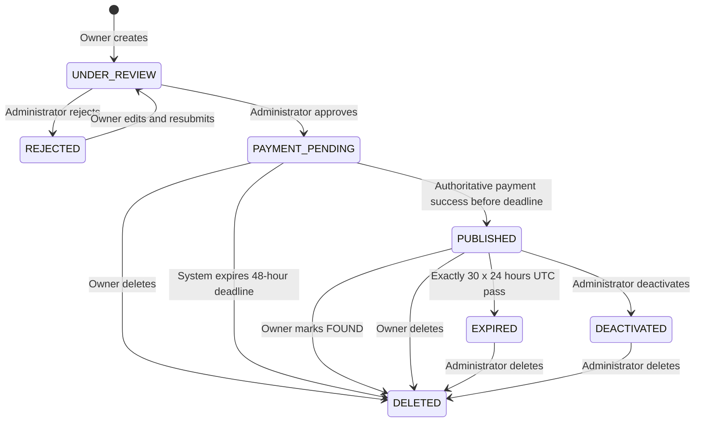
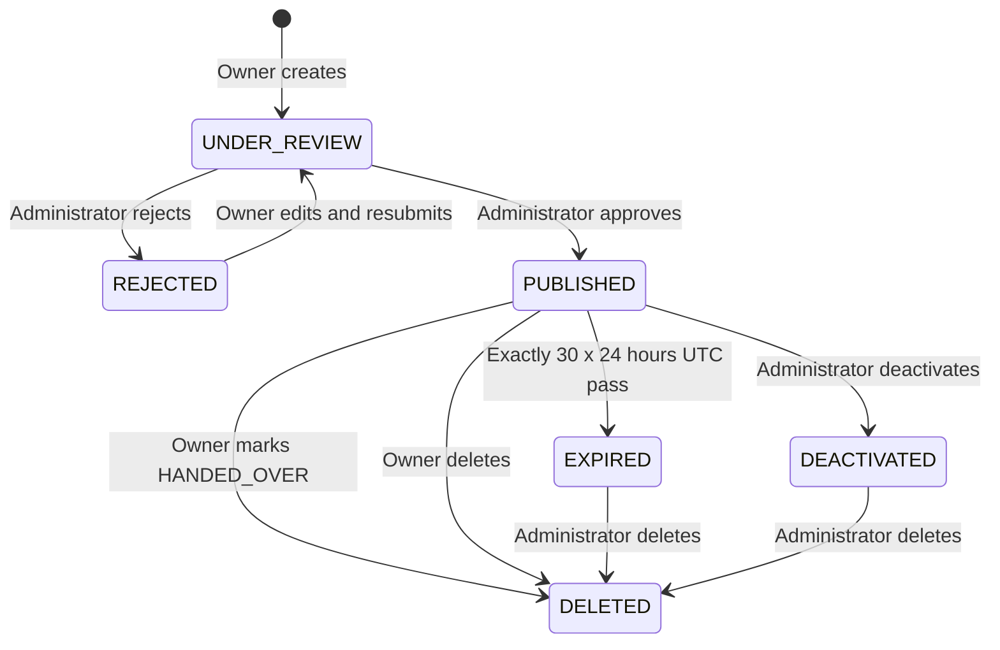

# Benji Lost & Found — Final Lifecycle and Hibernate Envers Audit Design

## 1. Scope and existing assessment

This is a final design specification. It does not implement lifecycle code or auditing.

The repository currently uses:

- Spring Boot `4.1.1`
- Hibernate ORM `7.4.5.Final`, managed by Spring Boot
- Spring Data JPA and PostgreSQL
- Spring Liquibase with `ddl-auto: validate`
- Spring Security
- The canonical `usermanagement.domain.User` UUID identity
- `JwtAuthenticationFilter.UserPrincipal` as the established JWT principal
- JPA entities in the modular-monolith packages
- MongoDB-backed Blog models, which are outside Hibernate Envers
- No existing Hibernate Envers dependency or Envers configuration
- No existing `@Audited`, `@RevisionEntity`, `@MappedSuperclass`, or revision listener infrastructure

The existing shared Lost & Found entity and status enum are current Phase 1/MVP behavior, not this approved lifecycle. They do not yet provide moderation, rejection history, independent Lost/Found state machines, the 48-hour Lost deadline, or UTC 30-day expiration.

Existing Payment boundaries are reusable: Payment owns transactions and an application-level `PaymentSucceededEvent`, Lost & Found uses `PaymentValidationUseCase`, and no direct ZarinPal or Payment infrastructure dependency is allowed.

## 2. Independent Lost lifecycle

Approved persisted states:

- `UNDER_REVIEW`
- `REJECTED`
- `PAYMENT_PENDING`
- `PUBLISHED`
- `EXPIRED`
- `DEACTIVATED`

Permanent deletion is a terminal operation, not a persisted state.

`DELETED` is the end of the row's lifecycle. There is no transition from `EXPIRED` or `DEACTIVATED` back to `PUBLISHED`.

## 3. Independent Found lifecycle

Approved persisted states:

- `UNDER_REVIEW`
- `REJECTED`
- `PUBLISHED`
- `EXPIRED`
- `DEACTIVATED`

Permanent deletion is a terminal operation, not a persisted state.

Found advertisements never enter a Payment state and never create a Payment transaction.

## 4. Lost transition table

| Source | Target | Actor | Precondition | Side effects and timestamps | Public | Owner edit | Owner delete | Reversible |
|---|---|---|---|---|---|---|---|---|
| Initial | `UNDER_REVIEW` | Owner | Authenticated owner; valid Lost DTO; non-null pet ID; server-side ownership succeeds | Set owner from principal; set created/resubmission timestamps; no Payment | No | Yes | Yes | No |
| `UNDER_REVIEW` | `REJECTED` | Administrator | Administrator authorization; non-blank rejection reason | Store immutable rejection record; set `rejectedAt`; preserve cycle/history | No | Yes | Yes | Yes, by owner resubmission |
| `UNDER_REVIEW` | `PAYMENT_PENDING` | Administrator | Administrator authorization; content approved | Set `approvedAt` UTC and `paymentDeadlineAt = approvedAt + 48h UTC`; no publication | No | No | Yes | Payment success or deadline deletion |
| `REJECTED` | `UNDER_REVIEW` | Owner | Owner match; owner made corrections; owner resubmitted | Increment cycle; set `resubmittedAt`; preserve rejection history; require fresh approval | No | Yes | Yes | Administrator may reject again |
| `PAYMENT_PENDING` | `PUBLISHED` | Payment event processor | Owner and ad still exist; state is pending; event not after deadline; authoritative transaction exists and is SUCCESS; LOST_PET_ADVERTISEMENT; reference and owner match; currency IRR; amount matches; transaction/gateway references match | Set `paymentSucceededAt`, `publishedAt`; set `expiresAt = publishedAt + 30*24h` UTC; consume event idempotently | Yes | No | Yes | No |
| `PAYMENT_PENDING` | Deleted | System | Deadline reached and no successful publication | Permanently delete row; do not create replacement or publication | No | N/A | N/A | No |
| `PAYMENT_PENDING` | Deleted | Owner | Owner match | Permanently delete row; later success may be reconciled by Payment and must not resurrect it | No | N/A | N/A | No |
| `PUBLISHED` | `EXPIRED` | System scheduler | `expiresAt <= now`, both in UTC; state remains PUBLISHED | Set `expiredAt`; remove from public queries; retain for administrator panel | No | No | Yes | No |
| `PUBLISHED` | `DEACTIVATED` | Administrator | Published row; administrator authorization; deactivation reason | Set `deactivatedAt` and reason/moderator; remove public visibility | No | No | Yes | No |
| `PUBLISHED` | Deleted | Owner | Owner match; owner marks pet FOUND | Permanently delete row; publish/record resolution audit only under the separate audit requirement | No | N/A | N/A | No |
| `PUBLISHED` | Deleted | Owner | Owner match | Permanently delete row | No | N/A | N/A | No |
| `EXPIRED` | Deleted | Administrator | Administrator authorization | Permanently delete row | No | No | N/A | No |
| `DEACTIVATED` | Deleted | Administrator | Administrator authorization | Permanently delete row | No | No | N/A | No |

## 5. Found transition table

| Source | Target | Actor | Precondition | Side effects and timestamps | Public | Owner edit | Owner delete | Reversible |
|---|---|---|---|---|---|---|---|---|
| Initial | `UNDER_REVIEW` | Owner | Authenticated owner; valid Found DTO; pet ID null | Set owner from principal; set created timestamp; no Payment | No | Yes | Yes | No |
| `UNDER_REVIEW` | `REJECTED` | Administrator | Administrator authorization; non-blank rejection reason | Store immutable rejection record; set `rejectedAt` | No | Yes | Yes | Yes, by resubmission |
| `UNDER_REVIEW` | `PUBLISHED` | Administrator | Administrator authorization; content approved | Set `approvedAt`, `publishedAt`; set `expiresAt = publishedAt + 30*24h` UTC; no Payment | Yes | No | Yes | No |
| `REJECTED` | `UNDER_REVIEW` | Owner | Owner match; correction and resubmission | Increment cycle; set `resubmittedAt`; preserve rejection history; require fresh approval | No | Yes | Yes | Administrator may reject again |
| `PUBLISHED` | `EXPIRED` | System scheduler | `expiresAt <= now` UTC; state remains PUBLISHED | Set `expiredAt`; remove public visibility | No | No | Yes | No |
| `PUBLISHED` | `DEACTIVATED` | Administrator | Administrator authorization; reason | Set `deactivatedAt` and reason/moderator; remove public visibility | No | No | Yes | No |
| `PUBLISHED` | Deleted | Owner | Owner match; owner marks pet HANDED_OVER | Permanently delete row; resolution audit requires separate design if history is required | No | N/A | N/A | No |
| `PUBLISHED` | Deleted | Owner | Owner match | Permanently delete row | No | N/A | N/A | No |
| `EXPIRED` | Deleted | Administrator | Administrator authorization | Permanently delete row | No | No | N/A | No |
| `DEACTIVATED` | Deleted | Administrator | Administrator authorization | Permanently delete row | No | No | N/A | No |

## 6. Actor authorization matrix

| Operation | Owner | Administrator | System/scheduler | Payment processor |
|---|---|---|---|---|
| Create | Yes | No | No | No |
| Edit under review/rejected | Yes, owner only | No | No | No |
| Resubmit | Yes, owner only | No | No | No |
| Reject | No | Yes | No | No |
| Approve | No | Yes | No | No |
| Start Lost Payment | No | No | No | Payment module exposes it only after approval |
| Publish Lost | No | No | No | Only after authoritative validation |
| Publish Found | No | Yes, approval transition | No | No |
| Mark Lost FOUND | Yes, owner only | No | No | No |
| Mark Found HANDED_OVER | Yes, owner only | No | No | No |
| Owner delete | Yes | No | No | No |
| Deactivate | No | Yes | No | No |
| Delete expired/deactivated | No | Yes | No | No |
| Expire | No | No | Yes | No |

## 7. Public visibility and ownership policy

| State | Lost public | Found public | Owner edit | Owner delete |
|---|---|---|---|---|
| `UNDER_REVIEW` | No | No | Yes | Yes |
| `REJECTED` | No | No | Yes | Yes |
| `PAYMENT_PENDING` | No | N/A | No | Yes |
| `PUBLISHED` | Yes | Yes | No | Yes |
| `EXPIRED` | No | No | No | Yes |
| `DEACTIVATED` | No | No | No | Yes |

Owner deletion is permanent database deletion in every owner-deletable state. Owner and administrator identities must come from the authenticated server principal, never request fields.

## 8. UTC deadlines and expiration

### Lost 48-hour payment deadline

- `approvedAt` is an `Instant` recorded in UTC.
- `paymentDeadlineAt = approvedAt.plus(48, ChronoUnit.HOURS)`.
- Payment success is accepted only if success processing time is not after the deadline.
- Payment callback data is never sufficient to publish. It must be validated against the authoritative Payment transaction.
- At or after the deadline, a system cleanup transition deletes the row if it remains `PAYMENT_PENDING`.
- A success event after the deadline is ignored for publication and remains a Payment reconciliation concern.

### 30 × 24-hour expiry

- Published `expiresAt = publishedAt.plusSeconds(30L * 24L * 60L * 60L)`.
- This is exactly 2,592,000 seconds and is independent of calendar-month or DST rules.
- Both timestamps must be stored and queried as UTC-compatible `Instant` values.
- The scheduler and public visibility queries use `expiresAt <= now`.
- Expiry does not reactivate or republish and is separate from administrator deactivation.

## 9. Rejection and resubmission workflow

1. Administrator rejects the current `UNDER_REVIEW` row.
2. Rejection requires a non-blank reason.
3. The row becomes `REJECTED`.
4. An immutable or append-only rejection-history entry records administrator, reason, UTC timestamp, and resubmission cycle.
5. Owner edits only the rejected advertisement content.
6. Owner resubmits, changing `REJECTED` to `UNDER_REVIEW`.
7. Every resubmission creates a new review requirement; no rejection/resubmission cycle limit applies.
8. Lost approval creates `PAYMENT_PENDING` and begins the 48-hour deadline.
9. Found approval creates `PUBLISHED`; no Payment record is created.

## 10. Lost Payment integration

The existing application boundary remains authoritative:

1. Administrator approval creates no Found or Lost publication.
2. Lost approval creates `PAYMENT_PENDING` and a 48-hour UTC deadline.
3. Payment initiation is allowed only after approval.
4. `LostPaymentEventValidator` delegates to the Payment application validation contract.
5. The contract verifies the transaction exists, status is SUCCESS, service type is LOST_PET_ADVERTISEMENT, service reference identifies this advertisement, user ID matches the owner, currency is IRR, amount matches the authoritative transaction/tariff snapshot, and transaction/gateway references match.
6. Lost & Found rechecks row existence and state under a transaction or optimistic-lock check.
7. It verifies the event time/processing time against `paymentDeadlineAt`.
8. Only then may it transition to `PUBLISHED`.
9. Lost & Found never calls ZarinPal or reads `payment.infrastructure`.

The existing `PaymentSucceededEvent.transactionId` is the stable duplicate-delivery identifier. A future persistent consumer deduplication mechanism is required; the current outbox is delivery infrastructure, not a Lost & Found processed-event table.

## 11. Permanent deletion and resolution

Owner resolution:

- Lost: owner marks the situation found through an operation that first validates ownership and PUBLISHED state.
- Found: owner marks the pet handed over through an operation that first validates ownership and PUBLISHED state.
- Neither operation creates a persisted `FOUND` or `HANDED_OVER` lifecycle state.
- It permanently deletes the advertisement row.
- A separate resolution/audit record would be required to preserve resolution facts; permanent deletion alone does not invent a retention requirement.

Owner deletion and administrator/deadline deletion permanently remove the row. Envers history remains separately stored, subject to audit retention policy.

Related reports, reveal logs, images, and image object-storage records require explicit future cleanup/retention decisions. Deleting the advertisement must not silently assume those records are deleted or retained.

## 12. Concurrency and idempotency

- Use optimistic row locking plus lifecycle state checks for owner delete, moderation, publication, resolution, expiry, and deactivation.
- Owner deletion and Lost Payment success are serialized or compared by row/version.
- If deletion wins, Payment success is stale and must not recreate or publish the row.
- If publication wins, subsequent owner deletion removes the row permanently.
- Duplicate `PaymentSucceededEvent` delivery produces at most one publication side effect.
- Payment success after deletion or deadline is ignored for publication.
- A callback is not a publication authority and can arrive before or after event delivery.
- Administrator approval and owner edit/resubmission use the same row/version guarantee.
- Expiry and administrator deactivation/deletion use state comparisons so stale operations cannot republish.
- Expiry is never reversible.
- Public queries require PUBLISHED and a future expiry timestamp.

## 13. Hibernate Envers system-wide architecture

### Existing technology

Recommended Envers is the Envers module matching Hibernate ORM `7.4.5.Final`, brought in with the Spring Boot dependency-management/BOM version rather than an independently conflicting version.

The project currently has no Envers dependency, no JPA auditing infrastructure, and no mapped superclass. The following is proposed documentation only.

### Audited entity policy

**Default: audit all JPA `@Entity` business entities.** This includes, without limitation:

- User and legacy identity entities
- Pet, breed, photo, and Pet Media entities
- Lost/Found advertisements and their moderation/rejection records
- Lost/Found reports, reveal logs, and image metadata
- Payment transactions, tariffs, outbox, idempotency records
- Consultation entities
- Lookup entities
- JPA USM/other business entities

MongoDB Blog entities are not managed by Hibernate and cannot be audited by Hibernate Envers. They need a separate MongoDB audit strategy if “all persistent business entities” includes them. No Mongo exclusion or replacement is silently assumed.

**Infrastructure entities**

The default audit policy may audit infrastructure entities for operational completeness, but the following should be identified explicitly:

- Payment outbox records: recommended audited because processing history and publication state are operationally important.
- Payment idempotency records: recommended audited unless treated only as ephemeral technical state.
- OTP challenges, refresh tokens, access/refresh-token artifacts: audit metadata but exclude secrets and volatile values.
- Legacy technical tables: no silent exclusion; require field-level exclusions.

The project has no mapped superclass. A future optional audit base should add only shared behavior and must not force Mongo entities or DTOs into JPA.

## 14. Custom revision metadata

Recommendation: use a custom `@RevisionEntity` with a numeric revision ID, a UTC timestamp, and actor metadata.

Conceptual fields:

- `revisionId: Long`
- `revisionTimestamp: Instant`, stored in UTC
- `actorUserId: UUID`, nullable
- `actorType: USER | ADMIN | SYSTEM | CALLBACK | SCHEDULED_JOB | ASYNC_EVENT`
- `correlationId: String`, nullable

Use the canonical `User.id` UUID. `JwtAuthenticationFilter.UserPrincipal.id` is the established internal principal ID. Do not use email or username.

The revision table should not contain mutable user names or email addresses.

## 15. Revision listener

The custom revision listener should:

- Read `SecurityContextHolder.getContext().getAuthentication()`.
- Recognize `UserPrincipal` and canonical `User` as authenticated actor types.
- Read the internal UUID directly.
- Derive ADMIN versus USER from trusted authorities/role.
- Use `SYSTEM` or `SCHEDULED_JOB` only for explicitly tagged system operations.
- Use `ASYNC_EVENT` or `CALLBACK` for event/listener processing when no application user action exists.
- Set a nullable actor ID and `SYSTEM` actor type when no SecurityContext exists.
- Never fail solely because SecurityContext is absent or anonymous.
- Never query the database or invoke remote services while building the revision.
- Never introduce a security-to-auditing or auditing-to-business module dependency.

The listener can read request metadata from an existing request/correlation interceptor if one is verified in the application. It must not fabricate a correlation ID from mutable or client-untrusted fields.

## 16. Revision types

Envers records:

- `ADD` for entity creation
- `MOD` for entity modification
- `DEL` for entity deletion

Revision queries join the entity audit table to the custom revision and inspect the revision type. This distinguishes:

- initial creation;
- field/state transitions;
- hard deletion.

Bulk JPQL/native SQL operations bypass normal Envers callbacks and must be audited or rejected.

## 17. Relationship auditing

Recommendations:

- One-to-many: audit owning and inverse sides only where each side is a business entity; use `@AuditJoinTable` for collections when join-table semantics require it.
- Many-to-one: audit normally, but use bare UUID or ID references when the project deliberately uses modular boundaries. This avoids cross-module foreign-key coupling.
- Many-to-many: audit collection membership and join-table data. The join table and relationship owner must be explicit.
- Collections of non-audited technical values: use `@NotAudited` only after impact analysis.
- `@NotAudited`: exceptional, documented field/relationship exclusions; not a default way to reduce audit volume.

Existing JPA relationships, such as LegacyUser addresses and roles, must be checked for collection changes and orphan removal. Auditing only the parent while omitting audited collection contents creates history gaps.

## 18. Sensitive fields

The exact exclusion recommendation is:

- OTP challenge values and generated/verified secrets: no audit values.
- Password hashes and credential data: no audit values.
- Refresh-token values and access tokens: no audit values.
- Payment gateway secrets, authorities used as secrets, ZarinPal credentials, and webhook verification secrets: no audit values.
- Payment gateway reference IDs: audit only if operationally required and not confidential.
- Contact phone/email/address values: evaluate masking or field exclusion. Public and audit requirements may conflict.
- Mobile numbers, profile phone numbers, and avatar object keys: audit only when a legal/business need exists; otherwise mask or exclude.
- Resolution notes and moderator reasons: audit if moderation requirements require them.
- IP address and user agent: audit only after abuse/privacy review.

Sensitive fields should use `@NotAudited` or application-level persistence of masked values. Envers auditing must not copy raw credentials or OTPs by accident.

## 19. Permanent deletion and audit retention

Envers writes deleted entity state to an audit table and a `DEL` revision. It does not preserve an audit row inside the original business entity table.

Recommended requirements:

- Original audit tables remain without foreign keys to live business rows.
- Revision metadata uses a revision-table foreign key from each audit row.
- Do not add cascade-delete behavior from the live table to audit history.
- The audit table primary key is `(original entity ID, revision ID/revision number)`.
- Permanent Lost/Found deletion creates a `DEL` revision, while its last audit state remains queryable.
- Related image metadata is deleted or retained according to a separate policy, but either behavior must produce documented Envers deletion/modification revisions.
- MinIO/object-storage contents are outside PostgreSQL Envers and require separate retention/deletion logic.
- No audit cleanup or archival policy is approved by this design.

## 20. Audit access

Audit history must not be public.

Recommended access:

- Administrator-only internal audit API or operational query service.
- Internal service access with explicit read authorization.
- History queries paginated and indexed.
- Sensitive fields masked or omitted.
- Access filtered by entity type and actor role.
- No public DTO exposes raw historical values.

## 21. Performance and operations

Envers adds one or more audit rows for every audited entity modification:

- One revision row per transaction/revision.
- Entity and collection audit rows for changed fields/collections.
- Additional writes during creation and deletion.

Recommended controls:

- Index audit entity ID and revision ID.
- Index custom revision timestamp and actor identity for operational queries.
- Keep existing JPA indexes and add audit-table indexes based on query plans.
- Expect revision-table growth and define future archival after a separate approved retention decision.
- Paginate history queries and never load unbounded revision chains.
- Keep revision creation in the business transaction.
- Bulk JPQL updates and native SQL must be prohibited for audited entities or followed by explicit audit handling.
- Scheduled expiration/deactivation and asynchronous Payment events must tag actors as system/async.
- Test transactions that update and delete audited entities.
- Test rollback: audit revisions and entity changes must roll back together.

## 22. Database and migration requirements

The owner must add migrations for all approved audit tables later. No migration is changed here.

Requirements to document in the future migration:

- Envers standard REVINFO or configured revision entity table.
- Custom revision columns: revision ID, UTC timestamp, actor UUID, actor type, correlation ID.
- An audit table for every audited JPA entity.
- Audit primary keys containing original entity identity and revision identity.
- Audit collection join tables where relationships are audited.
- Indexes on audit entity ID, revision ID, revision timestamp, and actor ID.
- No foreign key that cascades deletion from a live business row into audit history.
- PostgreSQL/Dialect-compatible column types.
- UTC timestamp storage compatibility.
- Liquibase entries owned by the project owner.

MongoDB Blog audit collection requirements are separate and cannot be satisfied by Hibernate Envers.

## 23. Testing strategy

Future implementation tests should verify:

- Every JPA business entity is registered for auditing or intentionally exception-listed.
- ADD, MOD, and DEL revision types.
- Custom revision actor ID and actor type.
- Missing/anonymous SecurityContext produces SYSTEM rather than an exception.
- Canonical and JWT principal IDs resolve to the same internal UUID.
- Revisions are transactionally consistent on rollback.
- Permanent Lost/Found deletion preserves the final and revision history.
- Rejection reason and resubmission history revisions remain queryable.
- Sensitive fields are absent or masked.
- Collection and relationship changes appear in audit history.
- Bulk update/native SQL bypasses are blocked or handled.
- Envers history access requires administrator/internal authorization.
- Expiration/deactivation revisions are marked system/scheduler, not a false administrator actor.
- Payment event revisions are marked async/event and do not contain an owner as actor unless the event is genuinely owner-initiated.

## 24. Remaining technical decisions

1. Final timezone representation in PostgreSQL: `Instant`/UTC consistently, not a zone-dependent local type.
2. Persistent Payment event deduplication mechanism.
3. Rejection-history representation: separate entity with append-only semantics.
4. Resolution/audit record retention after permanent advertisement deletion.
5. Report, reveal-log, image metadata, and object-storage retention after deletion.
6. Audit retention and archival duration.
7. Whether every JPA technical/outbox/idempotency entity is audited or selectively annotated.
8. MongoDB Blog audit strategy if system-wide audit includes MongoDB.
9. Index and retention sizing for audit volume.
10. Exact actor-role mapping for legacy and canonical principals.

## 25. Execution confirmation

No source code, configuration, dependency, test, entity, Liquibase/Flyway migration, changelog, or SQL file was modified. This deliverable updates only the design document.
